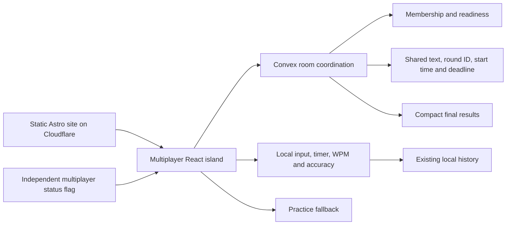

# NinjaType multiplayer: architecture, edge cases, and free-tier tradeoffs

Analysis date: 24 October 2026. This is an architecture assessment, not an implementation plan. No application code, infrastructure, accounts, or deployment settings were changed.

## Recommendation

Use Convex as a **room coordinator**, while all typing runs locally. Synchronize joining, readiness, the shared round definition and start time, and final results. Keep networking out of the keystroke and local analytics paths.

For a balanced experience, use a short-lived reactive subscription in the lobby, close that connection after receiving the shared round descriptor, and use bounded result retrieval after finishing. If maximum resource savings take precedence over an automatically updating lobby, an HTTP-only design with a predetermined future start is cheaper and avoids persistent session limits.

Convex Free cannot guarantee continuous multiplayer availability for an unlimited active user base. It can support a large overall audience when multiplayer participation is bounded and the application gracefully returns to practice after resource limits. Free-tier-only is achievable as a **zero-spend policy with bounded availability**, not a promise of unlimited service.

If the backend choice itself is flexible, Cloudflare Durable Objects is particularly well matched to a ten-person room and deserves serious consideration. It offers different, daily free allowances and fits the app's existing Cloudflare hosting, but requires more networking and room-lifecycle code.

## Existing application fit

- `astro.config.mjs` builds a static Astro site with React islands and a PWA service worker. No general application server is currently required.
- `wrangler.jsonc` configures Cloudflare Pages output.
- `src/pages/online.astro` mounts `OnlineKeyboardContainer` as a React island.
- `src/store/online.ts` manages the local lifecycle, 15/30/50-word tracks, a three-second countdown, input, timing, WPM, accuracy, and saving history. Its 200 ms timer is local.
- `src/lib/onlineRace.ts` contains reusable input normalization, word completion, and ranking rules.
- Current opponents are projections of saved attempts. No Convex integration or account identity layer was found.

The multiplayer island can reuse the local rules and presentation while giving its lifecycle a separate network coordinator. Multiplayer results need stable room/member/round IDs and explicit submission status, rather than treating a local finish as a confirmed shared result. Convex should be loaded only when someone enters multiplayer; solo typing and the recorded-attempt race can remain independent.

## Verified free limits

Sources: [Convex pricing](https://www.convex.dev/pricing) and [Convex limits](https://docs.convex.dev/production/state/limits), inspected on the analysis date.

| Resource | Current Free allowance | Consequence |
| --- | --- | --- |
| Function calls | 1,000,000/month | Queries, mutations, scheduled executions and subscription updates all consume allowance |
| Database I/O | 1 GB/month | Database document/index reads and writes can become a bottleneck even when responses are tiny |
| Database storage | 0.5 GB total | Keep ephemeral room state and expire it; rows and indexes both count |
| Concurrent sessions | 1,000 on S16 | Ten connected browsers in each room suggests about 100 full rooms before allowing headroom; tabs and other sessions also count |
| Concurrent query executions | 16 on S16 | Short indexed queries matter; this is not a limit of 16 users |
| Concurrent mutation executions | 16 on S16 | Many simultaneous joins/finishes queue or contend; transaction bodies should stay small |
| Action compute | 20 GB-hours/month | Ordinary query/mutation coordination can avoid needing actions in the gameplay path |

The platform also lists file storage and data egress allowances. The usage documentation defines egress around file downloads, outgoing fetches, and log streaming; do not assume every WebSocket query-response byte is an independently metered egress byte. Measure actual usage dimensions rather than substituting browser payload size for database I/O.

**Free and Starter are different:** Starter has a zero-dollar base with paid overages. Choose Free to honor the zero-spend requirement. Included allowances are shared across team deployments/regions as documented; extra deployments are not an unlimited free-capacity strategy.

## Proposed coordination architecture

The network flow is event-based:

1. The creator chooses or generates a room name. Creation is a single atomic mutation and also enrolls the creator.
2. Other players enter that **exact room name**. Joining performs an indexed lookup, checks expiry and phase, and atomically allocates a seat if fewer than ten exist.
3. The room displays a compact joined-player roster and readiness. The browser already has the typing UI loaded before it acknowledges readiness.
4. Starting creates one immutable round descriptor: `roundId`, exact text, mode, roster snapshot, `startAt`, `deadlineAt`, and a rules version. A five-to-ten-second future start is a reasonable initial synchronization allowance, subject to latency testing.
5. Every enrolled browser derives its countdown from that descriptor. Once it has the descriptor, it can close the lobby connection and type locally.
6. Each finisher submits one compact result. The backend derives WPM from agreed text length and accepted elapsed time; it checks membership, round ID, bounds, and deadline. This validates consistency, not proof that a human typed.
7. Results are retrieved on demand or through a short-lived subscription that ends when all players finish or the deadline passes. Earlier finishers observing later finishes create some result fan-out; a single fetch after the deadline is cheaper.

Use timestamps, not server timer ticks. The server need not update a record every second to change countdown/running/results labels. Clients derive those states locally; mutations enforce authoritative deadlines. A cached query that calls `Date.now()` does not become a timer or guarantee an update when time passes.

Suggested lightweight state boundaries:

| State | Contents | Reason to keep it separate |
| --- | --- | --- |
| Rooms | Exact name, creator/member authority, active round, expiry, read capability | Fast indexed lookup and room lifecycle |
| Members | Room ID, display name, membership credential hash, readiness | Atomic ten-seat enforcement and per-member authorization |
| Rounds | Shared text, immutable participant IDs, start/deadline, rules version | Read once; unaffected by each player's typing |
| Results | One compact result per member/round | Result changes do not invalidate the lobby/text query |

These are logical boundaries, not a final schema. A single bounded roster document can save reads, but rewriting it on every result increases I/O and contention. Per-member/result documents isolate updates but introduce more index/document reads. Benchmark both before choosing the physical layout.

Projection helps network payload size, but returning three fields from a large document does not necessarily turn its database read into a three-field read. Store data at the granularity of the queries that actually consume it.

## Exact names, invitations, and identity

Treat the room name as an invitation address. Use an indexed exact match, with documented handling of outer whitespace and case. A reasonable policy is trimming outer whitespace, preserving case, and permitting bounded ASCII letters, numbers, underscores and hyphens. Case folding or fuzzy suggestions would change the exact-name contract.

Generate an unpredictable name by default, while optionally allowing a custom name. A short familiar custom name is discoverable and should not be described as private or secure. Anyone with the exact room name can attempt to join; the UI should make this invitation behavior clear.

Room membership also needs an unguessable credential. A nickname, player ID, or room name must not authorize editing another player's result. A guest membership credential can be generated securely, persisted on the browser, bound to an immutable room ID, and checked server-side. Store credential hashes and keep secrets out of roster/result responses and logs. No social login or account creation is required for casual friend rooms.

A shared room-read capability allows enrolled players to request the same compact public snapshot. Identical query arguments can benefit from Convex caching. Per-user query arguments or auth-dependent results may prevent sharing the same cached evaluation. Preserve necessary authorization first, then measure cache behavior; caching is not a free substitute for security.

Duplicate tabs can share a seat through the stored membership credential. Server-side uniqueness on `(roundId, memberId)` prevents two results for that seat, although anonymous guests opening independent browsers can still occupy several seats. Strong one-human-one-seat enforcement would require a different identity policy.

## Resource controls

### Network lifetime

Limit subscriptions to the lobby and a bounded results window. Unsubscribe and **close the dedicated client connection** when it is no longer needed; removing a React query alone should not be assumed to remove a session. A Convex client mounted globally would unnecessarily connect people using solo practice.

Keep the local 200 ms timer and input events independent of Convex. A ten-person, sixty-second round with a network update every 200 ms would generate 3,000 writes before any observer updates. One final submission per player makes that ten result writes instead.

### Presence and retention

Display **joined**, not a guarantee of **currently online**. Constant heartbeat writes and corresponding observer updates are expensive. Use explicit leave when possible, creator removal in the lobby, expiry, and bounded readiness instead. Browser unload is only a best-effort hint.

A starting policy could be a fifteen-minute idle lobby expiry, a ten-minute maximum round, and a two-hour absolute room lifetime. These are proposed behavior defaults, not commitments. Keep the latest round/results needed for a rematch; personal history remains local.

Use one indexed, bounded cleanup sweep rather than one scheduler per player or a server tick per round. A fifteen-minute cron has roughly 2,880 executions in a thirty-day month before extra batches. Deleting data also consumes resources. Logical expiry must be enforced in mutations even if physical cleanup is delayed.

### Admission and fallback

[Convex usage limits](https://docs.convex.dev/production/usage-limits) document daily/monthly warning and disable thresholds. A disabled deployment rejects new function calls and re-enables when the UTC window rolls over, unless the relevant settings change. Check the available controls in the actual Free deployment before relying on a particular dashboard configuration.

Illustrative internal budgets are 700,000 calls/month and 0.7 GB/month of database I/O, with additional daily guardrails. They reserve allowance below the platform caps; the correct thresholds depend on measurements and other team usage. Warning notifications can prompt stopping new admissions, while hard disable protects the remaining budget. A hard disable can interrupt existing rounds, so it cannot guarantee successful completion for players already admitted.

Serve a small multiplayer status flag from Cloudflare, independently of Convex. Consult it on multiplayer entry, not each keystroke. It supports planned maintenance or an operator stop without asking a failing backend for its status. Runtime Convex/network errors must still be handled because the flag can be stale or the failure can be local to one user.

Local circuit breaking should stop new operations, subscriptions, and reconnect loops after a bounded failure window. Convex's reactive client normally reconnects and retries mutations; a UI timeout alone does not prove a mutation failed or stop its transport. Preserve idempotency IDs and close the dedicated client when falling back. Offer an explicit retry rather than continual per-player health polling.

The PWA must not make the multiplayer status flag or network room state look fresh using a stale offline cache. Practice assets can remain available offline while multiplayer status and submissions require fresh network handling.

### Abuse caveat

Client-side button throttling cannot protect the backend budget. Validate and bound names, result payloads, room creation, joins, and retries server-side. Rejected requests can still consume provider resources, so application limits inside a Convex function cannot provide an unlimited defense against traffic reaching it.

[Convex abuse protection](https://docs.convex.dev/production/abuse-protection) documents network-layer protection, but custom-domain application-layer WAF controls require Pro. A Cloudflare Worker gateway can reject ordinary abusive HTTP traffic before forwarding it, but introducing a gateway does not by itself make the public Convex endpoint inaccessible. It is not a zero-cost, unbypassable security boundary. Provider hard caps remain the final zero-spend safeguard.

## Capacity: users are not the unit of cost

Count **player-round participations**, room events, query invalidations, reconnects, database I/O, and simultaneous connected sessions. Someone using solo practice should consume zero Convex resources.

For one full room/round with ten players, basic event writes might include creation/enrollment, nine joins, ten one-time readiness acknowledgements, one start, and ten results: about 32 mutations before leaving and cleanup. Initial queries and observer updates add to this. Readiness changes observed by ten people and results observed by earlier finishers can substantially increase counted calls.

Illustrative function-only scenarios with a 700,000-call internal monthly budget:

| Assumed measured total calls per full room-round | Full room-rounds/month | Ten-player participations/month |
| --- | ---: | ---: |
| 50: very sparse/manual HTTP flow | 14,000 | 140,000 |
| 150: economical event subscription flow | about 4,667 | about 46,667 |
| 250: more lobby/result fan-out | 2,800 | 28,000 |

These are arithmetic scenarios, **not benchmarks or promised capacity**. Fifty calls assumes very little automatic refresh; it does not describe an always-live roster. Convex caches can reduce database reads, but the documented subscription-update call accounting must still be measured. Database I/O, storage, concurrency, other deployment usage, and retries can lower all these numbers.

For example, at 100 KB of measured database I/O per room-round, a 0.7 GB internal I/O budget accommodates about 7,000 full room-rounds. At 500 KB per room-round it accommodates about 1,400. Query arguments and data layout can therefore matter as much as mutation count.

One thousand daily multiplayer participants playing three rounds each means roughly 90,000 player-round participations/month. In the 250-call/full-room scenario, that requires approximately 2.25 million calls/month, above Free. A much larger overall audience with only a small multiplayer fraction may fit comfortably.

## Edge-case decisions

| Scenario | Recommended handling | Tradeoff |
| --- | --- | --- |
| Two creators choose the same name | Indexed name lookup and creation in one mutation; exactly one active room wins | An index is not itself a unique constraint; enforce in the transaction |
| Two people race for seat ten | Membership lookup/count and insertion in one mutation | Client-side seat counts are insufficient |
| Wrong spelling/case | Explicit room-not-found result; do not automatically create | Prevents accidental separate rooms |
| Long or malicious names | Bounded server validation, escaped display, bounded payload | Custom-name flexibility is limited |
| Someone guesses a short name | Treat name as shared invitation; encourage unpredictable defaults | Name-only access cannot promise strong privacy |
| Duplicate join or reopened tab | Reuse the membership credential and return the existing seat | Lost browser storage may require a new seat |
| Two tabs submit for one seat | Idempotent result key; first valid result is final | Does not prevent a person from creating separate guest identities |
| Player closes the lobby | Best-effort leave, creator removal, or expiry | Stale seats remain without heartbeats |
| Creator leaves after start | Round runs independently from the creator's browser | No host connection is needed for gameplay |
| Creator disappears before start | Allow any enrolled member to start when the agreed readiness conditions hold; otherwise wait for expiry or create another room | Avoids heartbeat-driven host election; a stale unready seat can still block |
| Multiple start clicks | Start mutation checks expected active round/state and returns the same descriptor | Settings and roster become immutable once started |
| Join during countdown/race | Lock the roster at start; existing members may reconnect, new players wait for a later round | No late-entry advantage or spectator fan-out |
| Browser clock is wrong | Estimate server-clock offset using an existing request's send/receive times; run elapsed time with a monotonic clock | Network asymmetry leaves small synchronization error |
| Background tab wakes late | Derive time from timestamps, not timer ticks; mark sufficiently late starts as missed | Perfect simultaneous activation cannot be guaranteed |
| Refresh mid-race | Recover the same round; preserve local progress only if safely available | Shared time continues; input is not stored on the server |
| Very slow or abandoned player | Deadline closes the round; show DNF/DNS | Others do not wait indefinitely |
| Two players tie | Shared ties or deterministic secondary ordering; apply one agreed policy | Stable ordering is not proof one actually finished first |
| Client fakes WPM/accuracy or pastes | Validate bounds and derive consistent WPM; label casual results | Strong human-typing verification requires more telemetry and cost |
| Finish request times out | Mark submission uncertain; preserve local result and reuse the same idempotency key on explicit retry | Timeout does not prove the write failed |
| Connection drops during typing | Continue local typing from the cached descriptor; attempt a bounded submission if appropriate | Shared confirmation may be unavailable |
| Convex is paused or quota-disabled | Multiplayer-unavailable banner, stop network activity, offer practice | Availability lasts only within the free resource budget |
| Hard cap occurs during a round | Let the local run finish as practice; do not claim a confirmed shared ranking | Active rounds cannot be guaranteed at hard disable |
| Round changes while an old result is pending | Bind submission to immutable round/member IDs and reject obsolete rounds | Never attach an old finish to the next round |
| Expired name is reused | New immutable room ID and new credentials | Old invites/credentials must not authorize the replacement |
| Frontend/rules versions differ | Share exact bounded text and a rules version; require compatible rules | A seed alone is unsafe without a pinned dictionary and algorithm version |
| Cleanup runs after an outage | Recheck expiry/current round before deletion; batch work | Stale scheduled work must not delete an active replacement |
| User is offline but others are online | Explain the user's connection failure; avoid claiming a confirmed global outage | Same practice fallback, more accurate message |

Transaction guarantees are supported by [Convex OCC and serializability](https://docs.convex.dev/database/advanced/occ). Mutation retries and reconnect behavior are documented in [the React client](https://docs.convex.dev/client/react). Idempotency is still required for newly issued retries, duplicate tabs, and old-round submissions.

## Alternatives and tradeoffs

| Option | Strength | Cost/resource downside | Suitability |
| --- | --- | --- | --- |
| Convex with short-lived event subscriptions | Good automatic lobby and easy atomic backend; fits React island | Subscription fan-out, monthly I/O, 1,000 session cap | Recommended balanced Convex design |
| Convex HTTP-only with host-controlled start and polling | No persistent connections; explicit requests and errors | Polling unchanged rooms spends calls; synchronization needs a future start plus bounded polling | Useful if delayed lobby updates are acceptable |
| Convex HTTP-only with predetermined start | Creation/join returns the text and future start; minimal requests | Users must join before that time; less flexible waiting/ready experience | Cheapest Convex variant for the stated minimal-insight requirement |
| Cloudflare Durable Objects, one room coordinator per object | Natural room isolation, atomic local room state, direct broadcasts, current Cloudflare hosting | More implementation work; request, duration and storage-write caps; hibernation/expiry need care | Strong alternative if maximum free headroom is the main goal |
| WebRTC peer-to-peer | Gameplay traffic bypasses a database | Still needs signaling; NAT failures may require TURN; host loss and trust become harder | Poor first choice for reliable ten-person friend rooms |
| Self-hosted Convex | More control over limits | Hosting, operations and monitoring are not automatically free | Only useful if suitable infrastructure is already available |

Current [Durable Objects pricing](https://developers.cloudflare.com/durable-objects/platform/pricing/) lists Free support for SQLite-backed objects: 100,000 requests/day, 13,000 GB-seconds/day, 5 million row reads/day, 100,000 row writes/day and 5 GB total storage. The [Workers Free allowance](https://developers.cloudflare.com/workers/platform/pricing/) is separately 100,000 dynamic requests/day and 10 ms CPU per invocation. Both must be budgeted.

For WebSockets, Cloudflare documents that outgoing messages are not billed as requests and incoming messages use a 20:1 billing ratio. Hibernatable sockets can avoid idle duration consumption; ordinary long-lived active sockets can burn duration. Deletes and alarms also consume storage-write resources. These rules can favor sparse room coordination, but they are not directly comparable to Convex function-call accounting and do not promise unlimited free capacity.

The static practice site should remain available regardless of whichever multiplayer backend reaches its limits.

## Fallback behavior

Suggested primary text:

> Multiplayer is temporarily unavailable. You can keep practicing while we get it back online.

Offer **Practice typing** and **Try multiplayer again**. For a local offline condition, use **Connection lost. You can still practice offline** instead. Room-not-found and room-full errors are normal room outcomes and should not trigger maintenance mode.

When failure occurs during an existing round, preserve the sentence and local result. Explain that a shared result could not be confirmed. Avoid silently queueing unlimited old results to send when the backend returns. A known quota-disabled state should not trigger continuous health checks until the relevant reset window or an explicit retry.

## Decisions needed before an implementation plan

The architecture does not depend on account login, continuous presence, or live progress. The choices that materially affect the next design are:

1. **Experience versus minimum usage:** an automatically updating lobby/shared start, or HTTP-only predetermined starts?
2. **Scoring trust:** casual friend results with consistency checks, or a more expensive anti-cheat requirement?
3. **Availability target:** expected daily multiplayer participations and peak people waiting/finishing, rather than total app visitors?
4. **Backend preference:** Convex specifically, or Cloudflare Durable Objects if its free allowances and room model fit better?

Given the current request, the default assumptions are casual friend races, ten seats, no networked progress, ephemeral room state, local history, and accepted practice fallback whenever multiplayer cannot operate within the free budget.

Saved source captures are in `evidence/`. No runtime capacity benchmark was conducted, and no application implementation was started.
