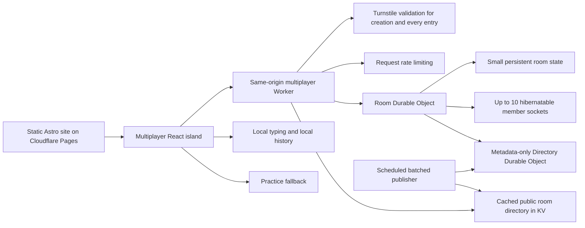
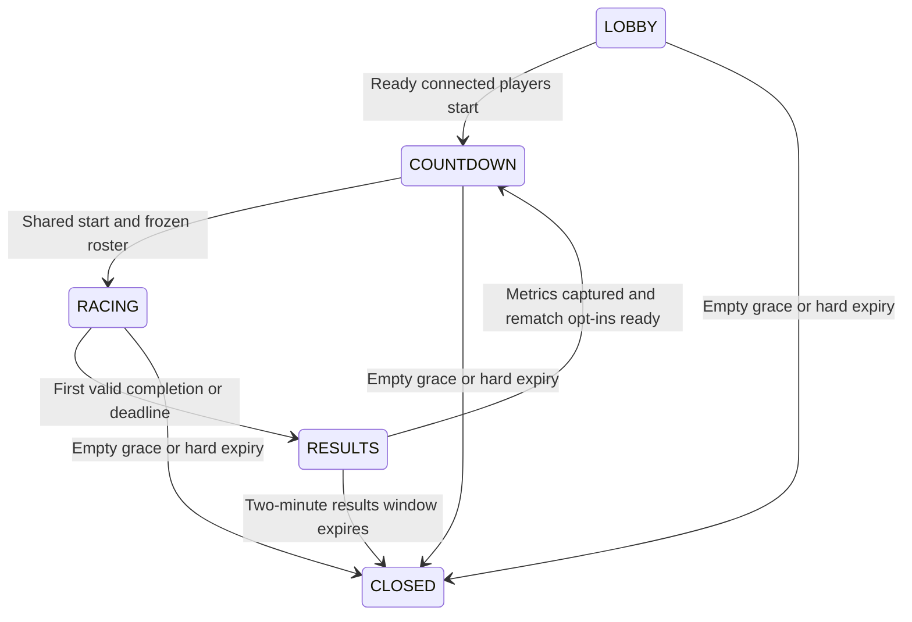

# NinjaType multiplayer: public nickname rooms on Durable Objects

Updated: 24 October 2026. Architecture analysis only. No application code, accounts, bindings, or infrastructure settings have been changed.

## Accepted requirements

- Players enter a nickname or receive a generated nickname. No login, signed guest credential, authentication cookie, or account system.
- The gateway checks same-origin browser requests. Rooms check existence, capacity, and participation in the round.
- A room has at most ten player/member sockets. Players can join friends by exact room name or discover public rooms and play with strangers.
- There is **no application-wide maximum number of rooms**. The earlier proposed 50-room cap is removed.
- Every room has a fixed maximum lifetime of **20 minutes from creation**.
- When the last player disconnects, allow a **two-minute reconnect window**, then disband the room if it remains empty.
- A round ends when **the first valid completion is accepted or the round deadline expires**.
- Results, winner information and final player metrics are displayed in that room.
- The results window lasts **two minutes**, with rematch available after metrics are captured.
- A rematch repeats the round lifecycle with a new round ID. It does not extend the room's original 20-minute expiry.
- Every room creation and entry requires server-validated Turnstile, including exact-name joins, public-room joins, and reconnects. Creation, browsing, joining/reconnecting and socket commands have rate limits.
- Generate DiceBear avatars entirely client-side using a deterministic hash of the accepted username as the seed.
- Typing, input feedback, WPM calculation and personal history remain local.
- Multiplayer failures fall back to practice. All services remain on their Free plans.

## Recommended architecture

Use a dedicated multiplayer Worker on a same-origin API route, one SQLite-backed Room Durable Object per exact name, a metadata-only Directory Durable Object, and a batched public directory snapshot in KV.

The Directory object **does not admit rooms, reserve capacity, or enforce a global room cap**. It collects small discovery records so KV can be updated in batches. Each Room object independently decides whether a join or game command is valid.

The existing Astro site remains static. Only /api/multiplayer/* uses the dynamic Worker; practice assets bypass it. The Worker exports the SQLite-backed Room and Directory classes and their namespace bindings. A Pages Function forwarding to this Worker is an alternative when a same-origin Worker route is unsuitable, with another integration hop to account for.

A dedicated Worker is the preferred gateway here because the documented Rate Limiting binding is directly configured on Workers. Do not assume every Worker binding can be configured identically in Pages Functions.

SQLite-backed classes are required for Durable Objects on Workers Free. Choose and test a compatibility date for the new backend independently from the existing Pages configuration; current dates support automatic WebSocket close-frame replies and deleteAll() alarm cleanup.

## Alternatives and trade-offs

| Option | Advantage | Trade-off |
| --- | --- | --- |
| Room DOs with hibernatable sockets and batched KV discovery | Authoritative room transitions; sparse messaging; idle sockets can hibernate | Separate directory coordination and cleanup; Free quotas still bound daily usage |
| Room DOs with one KV entry per room | Simpler discovery publication and automatic KV TTL | Per-creation writes and listing operations reach KV Free allowances sooner |
| Room DOs with exact-name joining only | Removes directory reads, publication and metadata storage | Does not satisfy public room discovery unless another discovery mechanism is added |
| HTTP polling instead of sockets | Simpler connection handling | Repeated requests while idle and slower end-of-round delivery; poor fit for minimizing Free-tier usage |

Removing the global cap eliminates the need for serialized admission counting. It also allows a burst of valid creations to consume shared provider allowances sooner. Keep creation throttling and bounded room work; availability falls back to practice when Free quotas are exhausted. No paid-plan overflow or replacement global room cap is proposed.

## Existing app integration

The current /online page mounts a React race interface. src/store/online.ts runs timing, typing, WPM, accuracy and local history; src/lib/onlineRace.ts contains reusable text normalization and completion rules.

Give multiplayer a separate coordinator/store while reusing these local rules and presentation. The existing recorded-attempt projection must not be presented as the progress of real players. Room members show joined/ready/playing/finished/stopped states and final metrics; typing progress is not transmitted continuously.

The multiplayer client is created only on multiplayer entry. Solo practice and recorded-attempt racing require no multiplayer backend.

## Nicknames, same-origin checks and participation

Ask for a bounded nickname, or generate one. Render names as text and handle duplicates visibly, for example by assigning a suffix. Nicknames cannot be a secure identity or a dependable rate-limit key.

### Client-side DiceBear avatars

Use the bundled DiceBear JavaScript library with one pinned style/version, proposed Identicon. Compute SHA-256 over the UTF-8 bytes of the accepted display username, including any server-assigned duplicate suffix, and pass its hexadecimal hash as the avatar seed. Preserve username case and use the same normalization on every client. The same accepted username and style/version produce the same avatar for all room viewers.

Generate the SVG locally and memoize it by seed; do not call the hosted DiceBear API or store avatar images/hashes in Durable Objects or KV. Broadcast only the accepted nickname already needed by the room. Hashing is deterministic presentation, not identity verification or anonymization. Two users with the same accepted name in different rooms can have the same avatar.

Use fixed library-owned style/options, render the generated SVG as an image, and show initials if generation fails. Provide the visible nickname beside the image and an appropriate accessible label. Check the selected style's license and attribution requirements before implementation. Avatar generation consumes client CPU and static bundle bytes, with no additional multiplayer requests or database writes.

Assign an internal participant ID when a socket is enrolled. Store it with the nickname and room epoch in the browser for reconnect correlation; attach the accepted identity to the socket. This is an unsigned correlation identifier, not an account credential or proof of identity.

Game messages act on the participant bound to the accepted socket. A client-supplied player ID in a FINISH payload must not choose whose score to update.

The gateway checks the exact allowed Origin for WebSocket upgrades and JSON POST operations. Read/list APIs can use same-origin JSON POST requests so the browser consistently provides an Origin; cached directory responses can still be handled internally using a suitable cache key. Reject unexpected browser origins and request shapes.

Origin checking blocks unwanted browser cross-site use. Non-browser clients can spoof Origin, so it is not cryptographic authentication. Turnstile, resource limits, and bounded server behavior supply the requested abuse controls without introducing a login system.

Reconnect correlation under this policy is deliberately weak. A matching prior participant ID/nickname may reclaim a disconnected seat during its grace window, but those values do not prove the original person returned. Do not promise protection against deliberate nickname/identifier impersonation. A currently connected seat should not be taken over merely by supplying the same nickname.

At the shared start, freeze the IDs of players who are connected and ready. Only those IDs can submit completion/final metrics for that round. Members who arrive afterward can wait for the next round and view room results; they cannot acquire participation retroactively.

## Room creation, lookup and joining

Room names use exact matching after a documented normalization policy: trim outer whitespace, preserve case, and bound the supported characters/length. Generated names are convenient defaults; public discovery means names are addresses, not secrets.

A stable namespace key such as room:v1:<exact-normalized-name> maps requests to the same Room object. Two creations of the same active name reach that object and cannot initialize two active versions. There is no global count lookup.

Creation flow:

1. Apply gateway request validation and inexpensive rate limits.
2. Verify the Turnstile token server-side, including expected hostname and action create_room.
3. Call the name-derived Room object to initialize the room atomically.
4. Set createdAt, roomExpiresAt = createdAt + 20 minutes, and an initial empty-room deadline if no socket has joined yet.
5. Record an idempotent creation receipt and return the room name and epoch.
6. Register discovery metadata with the Directory object. Publication can lag; the exact-name join must already work.

Turnstile tokens are single-use and valid for five minutes. Use a stable Siteverify idempotency key for retries, and bind application creation retries to the same request ID and payload. A repeated successful request must return the original outcome, even if its room was subsequently closed; it must not create a second room using the old verification. Retain bounded receipts for the retry/token window. Turnstile secrets stay only in the backend.

If validation fails or Siteverify is unavailable, creation and all new entries fail closed. Already-connected players can continue playing and rematching when the room backend works. Rematching on an existing socket is not another entry; reconnecting or opening a new socket is and requires a fresh verification.

Join flow can combine enrollment and the WebSocket upgrade in one request:

- User enters a nickname and exact room name, or selects a public room.
- Gateway validates Origin, request bounds and join/reconnect rate limits.
- Gateway verifies a fresh Turnstile token server-side, with the expected hostname and action join_room, before admitting the socket. This applies equally to creators entering their room, public-room visitors, exact-name joins and reconnects.
- Room object verifies existence, epoch, lifetime and capacity.
- It restores a disconnected participant where appropriate, or allocates a new seat.
- It accepts a hibernatable socket and sends a fresh room snapshot.

Keep the combined enrollment/upgrade path: the browser can carry the challenge token in a dedicated WebSocket subprotocol header entry, since browser WebSocket APIs cannot set arbitrary request headers. Encode it safely, enforce bounded lengths, and select only the fixed application protocol in the upgrade response. Never echo or log the token or place it in the room URL. Verify before accepting the socket; recheck room expiry and availability afterward because Siteverify can take time.

Creation and a later join are separate operations and require separate tokens; a creation token cannot be reused for entry. Transport retries use the same operation ID and Siteverify idempotency key, but cannot obtain a second admitted socket from an already-consumed operation. A replacement connection gets a new challenge token. Validate the raw Turnstile token's documented maximum length of 2,048 characters before Siteverify. No long-lived entry permit, auth cookie or reusable guest credential is introduced.

An unknown name returns not-found without initializing a placeholder room or scheduling cleanup. An old room name reused after deletion receives a new random room epoch. Old round messages and reconnect IDs cannot silently attach to the replacement.

Count connected members and seats reserved for the two-minute reconnect window toward the ten-seat limit. The limit applies to all room member sockets, including members waiting for the next game or viewing results; there is no unlimited spectator socket pool.

## Public discovery using KV

KV is eventually consistent. New/removed entries may take 60 seconds or more to become visible in other locations. A cached listing is a discovery hint; the Room object is authoritative for existence, expiry, seats and round eligibility.

Do not increment a KV room counter or treat a cached count as an admission gate. There is no global room cap to enforce.

Recommended directory strategy:

- Each room sends a small registration record containing name, epoch, createdAt and roomExpiresAt.
- Room deletion sends a best-effort removal for that epoch.
- The Directory object stores those records and prunes expired ones.
- Publish one compact active-room snapshot to KV about every three minutes.
- Serve bounded pages from that snapshot with edge caching.
- Fetch the listing on entry or explicit refresh, rather than polling it from every player.
- Filter records past their hard expiry and validate every actual join against the room.

A three-minute publisher performs about **480 KV writes/day**, leaving margin below the Free allowance of **1,000 writes/day**. It avoids per-room KV writes and the Free **1,000 list operations/day** bottleneck. The directory is one ordinary KV read, not a KV.list() call per visitor.

This is a batcher/index, not a new global admission authority. It receives creation/removal metadata, not keystrokes, readiness changes or every player result. Near-real-time occupancy counts and phase labels are optional; a room card can simply state that the room supports up to ten players and let joining resolve the current state.

A simpler alternative writes one expiring KV key per room at creation. It needs only one write per room and automatic TTL expiry, but the Free write allowance becomes roughly 1,000 published creations/day before other writes. Public listing also needs cached/paginated KV.list() operations. Use the batched directory for the stated larger-user-base goal.

With no application room cap, snapshot size, Directory working-set size and gateway CPU must be monitored. Pagination bounds response size, not the number of creatable rooms. At much larger traffic, partitioning directory snapshots may be necessary; each additional KV publication increases write usage.

If KV discovery is unavailable or stale, explain that the room list is unavailable and retain exact-name joining when Room objects still work. A listing failure should not falsely label every existing game as offline.

## Round lifecycle: first completion ends the game

Initial start requires at least two ready connected players. The shared countdown gives time to load the agreed passage. At the start transition, verify availability and freeze the actual roster. A member who is absent then cannot submit a valid finish for that round. A single start alarm can perform this transition; it is not a recurring server timer.

Publish exact text, round ID, server time, startAt and a round deadline clipped to the remaining room lifetime. Countdown, typing input, elapsed time, WPM and accuracy run locally.

The **first valid FINISH accepted by the Room object** atomically records the winner and ends the round. Other participants stop typing when they receive ROUND_ENDED. Near-simultaneous completions are serialized; later arrivals cannot replace the accepted winner. This favors first server receipt and therefore includes network-latency effects. It is a casual race, not a guarantee of perfectly ranked human completion times.

If the round deadline occurs first, end the round with reason timeout. There is no completed winner in that case; display ranked stopped-player metrics separately instead of claiming somebody finished.

When the round ends:

1. Broadcast ROUND_ENDED with round ID, reason, server end timestamp and winner if present.
2. The winner's FINISH supplies their final metrics.
3. Other roster participants submit one REPORT_METRICS snapshot of their stopped run.
4. Broadcast the room scoreboard as metrics arrive.
5. Allow a short initial collection deadline, proposed ten seconds, before marking missing submissions unavailable.
6. Keep results/rematch available until min(roundEndedAt + two minutes, roomExpiresAt).

Accept a late metrics report during that same results window if the round remains current. Once a rematch begins, reject stale round submissions so they cannot modify the new game. Show unavailable metrics honestly; do not invent zero scores.

Local clients stop on receipt of the end event. With no server-side keystroke stream, small network-delay differences in stopped-player progress cannot be reconstructed exactly. Use the agreed end timestamp for the duration policy and document this casual-scoring limit.

The remaining players do **not** continue until they individually finish. There are no regular progress uploads during the game.

## Rematch behavior

Expose Rematch after the player's final metrics are captured, or the initial collection deadline closes. Rematch is an opt-in; it does not force every result viewer to play again.

The proposed default is:

- Record each connected member's next-round opt-in/readiness.
- Once at least two opted-in members are ready and the previous round's initial metrics collection is closed, start one shared next-round countdown.
- Give that round a new ID and passage, and clear its completion/metric state.
- Freeze the connected opted-in roster at the shared start.
- Members who did not opt in can remain room members/results viewers and wait for a later game.
- If no rematch begins during the two-minute results window, disband the room.

Only one transition can create a rematch; duplicate clicks return the existing state. A lone rematch vote does not keep a room alive indefinitely. Do not begin a new countdown if there is insufficient time before the fixed room expiry.

The same start → first completion/deadline → results → rematch cycle repeats while the original room remains alive. A rematch never resets its 20-minute clock.

## Room lifetime and two-minute network grace

The hard deadline is fixed at room creation. At or after it, reject new joins/starts/metrics, send ROOM_CLOSED where possible and remove room state, even if people are connected.

When the last connection closes:

- Preserve the room and participant seats for up to two minutes.
- Schedule emptyDeleteAt = min(lastDisconnectAt + two minutes, roomExpiresAt).
- Cancel the empty-room deadline if a valid member/new join reconnects before it.
- Continue the shared clock; a network interruption does not pause a game or extend a deadline.
- Disband if it remains empty when that deadline arrives.

Individual disconnected seats also receive bounded two-minute reconnect reservation. Avoid scheduling one timer per player; prune expired reservations on the room's next event or one next-deadline alarm.

The result deadline, empty deadline and hard room deadline are independent. The earliest applicable deadline wins. For example, an empty room at minute 19 has at most one minute of grace; a room in its results window cannot extend that window just by reconnecting.

Silent network failures are not immediately observable without heartbeats. Start the grace window when the server observes a disconnect; the hard 20-minute alarm remains the ultimate lifetime bound.

## Persistence, hibernation and cleanup

Store one bounded room snapshot containing:

    roomName, roomEpoch, createdAt, roomExpiresAt
    sequence, phase, roundId, exactText, settings
    startCandidates, participantIds, startAt, roundDeadlineAt
    roundEndedAt, endReason, winnerId, metricsCollectionDeadlineAt
    resultsDeadlineAt, emptyDeleteAt
    members[<=10]: participantId, nickname, ready, disconnectedUntil, metrics, rematchOptIn
    bounded idempotency receipts

The current scoreboard remains in the room. Personal history remains in the existing local browser history. Retain at most the previous results needed for the rematch transition, not unlimited server-side race history.

Persist meaningful transitions before acknowledging them. Room commands should validate and write atomically without external network calls inside the seat/round critical section. Do not opt out of normal output gates for accepted finishes.

Use the Hibernation WebSocket API. Recover persisted room state on wake, and rebuild socket membership/rate-limit state from small serialized attachments. Connection IDs/attachments are not account credentials.

Use one alarm slot for the next of shared start, round deadline, initial metrics deadline, results deadline, empty grace, seat expiry or hard expiry. Recompute that deadline only on meaningful events. Alarms are at-least-once and may be delayed; every handler rechecks epoch, round and timestamps before acting.

Do not run a server interval or outbound relay while players type. Idle hibernatable room sockets can remain connected without accruing idle object duration.

Cleanup closes sockets, clears alarms as required by the selected compatibility date, calls storage.deleteAll(), clears memory and sends a best-effort directory removal. Logical expiry is checked on every operation even if an alarm is delayed. Directory removal compares room epoch so an old cleanup cannot remove a replacement room.

Registration/removal are not atomic across two objects. Failure to publish or remove a discovery record affects browsing, not authoritative room existence. Directory hard-expiry pruning and actual join validation limit stale records. Repair/retry this metadata work in a bounded way; do not pin a room awake with a persistent external request.

## Rate limits and Turnstile

Suggested starting limits, to tune after usage measurements:

| Operation | Proposed control |
| --- | --- |
| Room creation | One attempt/minute per browser identifier; coarse five/minute per IP; Turnstile on every creation |
| Public directory | Six reads/minute per browser; cached responses; generous coarse IP protection |
| Join/reconnect | Twelve attempts/minute per browser; a generous IP ceiling for shared networks; fresh server-validated Turnstile for every entry |
| Socket commands | Ten commands/ten seconds per bound participant |
| SYNC/resync | Two/ten seconds per participant, within the overall command budget |
| Start/rematch | One transition per round; at most one new countdown/ten seconds per room |
| Final metrics | One accepted result per participant/round; duplicate retries do not write again |

Browser identifiers are client-controlled and not authentication. Use them for friendly per-browser throttling, with IP/Turnstile/room constraints as additional controls. Renaming a nickname should not reset the bound socket's limiter.

Gateway Rate Limiting bindings are approximate and location-scoped. They do not provide a strict worldwide per-person quota. IP limits should be coarse because classrooms, offices and mobile users can share an address. Per-room socket limits run in that room and survive hibernation using attachments or bounded server state.

The gateway validates Turnstile before room creation and every socket admission. Socket commands and rematches on an already admitted connection do not call Siteverify. Challenge failure prevents creation and entry, including reconnects, while already-connected games may continue. Directory browsing requires rate limits, not a challenge, because it does not admit a player to a room.

A valid origin and solved creation/entry challenges do not establish player identity or score integrity. Attackers can still solve challenges, rotate identifiers or claim casual scores. Resource safety depends on limits, bounded room work and Free-tier fallback.

## Free-tier accounting with the cap removed

Current allowances captured from official pricing:

| Resource | Free allowance |
| --- | ---: |
| Dynamic Worker requests | 100,000/day |
| Durable Object requests | 100,000/day |
| Durable Object duration | 13,000 GB-seconds/day |
| SQLite row reads | Five million/day |
| SQLite row writes | 100,000/day |
| SQLite stored data | 5 GB total |
| KV reads | 100,000/day |
| KV writes | 1,000/day |
| KV list operations | 1,000/day |

Daily allowances reset at 00:00 UTC. Stored data persists until deletion. Other projects on the account share relevant quotas.

There is no arbitrary room-count cap, but no claim of unlimited Free capacity. Rooms, socket handshakes, directory traffic, reconnects, metrics and metadata writes all consume allowance. Provider quota exhaustion may happen while fewer than any particular number of rooms are active.

Combining join/enrollment with the socket upgrade reduces the earlier two-request entry flow. A fresh full room can use one creation request plus ten member upgrades before gameplay; add directory registration/publication/removal overhead.

Each creation and each of those upgrades now also performs a Siteverify subrequest. Reconnects add verification work as well. Keep those calls in the gateway rather than pinning a Room object awake; rate-limit before verification. If header-based token transport proves unsuitable, a POST admission step followed by upgrade is an alternative, but requires a tightly bounded single-use admission receipt and another gateway request per entry. The recommended direct-upgrade design avoids that extra request and receipt.

With first-finisher termination, a normal ten-participant round produces one FINISH plus up to nine REPORT_METRICS submissions. READY, START, end, rematch opt-ins, alarms and persistence still count. Incoming socket messages use the published 20:1 request billing ratio; outgoing broadcasts do not add billed requests, but handling/storage work still costs resources.

The earlier 40-write capacity example is no longer a sufficient estimate for this richer lifecycle. If an eventual benchmark measured **50 total storage-row writes per full room-round**, a conservative 60,000-write/day working budget would imply:

    60,000 / 50 = 1,200 full room-rounds/day
    1,200 × 10 = 12,000 player-round participations/day

This is an illustrative scenario, not measured capacity or a newly imposed daily room cap. More retries, rapid rematches, partial rooms and other account usage can lower it.

Batching one KV snapshot every three minutes uses about 480 writes/day rather than one KV write for each creation or player event. Extra snapshots/shards and other KV usage must fit in the remaining allowance.

Hibernation remains essential. Standard sockets or recurring server timers can consume the duration allowance even when players are typing locally. Track actual requests, writes, duration, retained storage and directory traffic before sizing throughput expectations.

## Failure behavior

A static multiplayer status flag and gateway setting support maintenance without requiring a room lookup. Client-side fallback is independent of the dynamic backend.

If the Worker, Room storage or socket acknowledgment fails, preserve the local run, use bounded reconnect attempts during the grace window, then show:

> Multiplayer is temporarily unavailable. You can keep practicing.

Offer practice and an explicit retry. A socket timeout means submission is unconfirmed, not necessarily rejected; use the same operation ID on retry.

Every reconnect attempt needs a fresh challenge verification. Use bounded backoff, let the widget resolve a challenge before attempting admission, and avoid tight challenge/reconnect loops. Turnstile may require interaction or take longer than the two-minute grace; it does not extend that grace or the room's hard expiry.

If only discovery fails, show a directory-specific error while retaining protected direct joining where possible. If only Turnstile validation fails, creation and all new entries are unavailable while already-connected room members can continue. Room-full, room-expired, stale-round and nickname conflicts are ordinary game outcomes.

Changing an HTTP gateway maintenance flag does not disable existing socket commands. Full shutdown requires room-side enforcement/deployment or socket closure. Exclude API/status data from stale PWA caching; keep static practice available.

## Edge-case checklist

| Scenario | Behavior |
| --- | --- |
| Two creators choose the same name | Atomic initialization in the name-derived room; no room-count reservation |
| Eleven players join concurrently | Ten seats maximum, including reconnect reservations |
| Join/reconnect has a missing, expired or replayed Turnstile token | Reject admission; request a fresh challenge, without allocating a seat |
| Challenge completes after reconnect grace or room expiry | Recheck room state; no extension or resurrected room |
| Turnstile outage | Creation/new entry unavailable; existing sockets and practice may continue |
| KV shows a deleted/full/racing room | Actual room resolves existence, capacity and current eligibility |
| Directory registration fails | Exact-name join works; discovery can lag and repair is bounded |
| Duplicate nickname | Visible suffix/conflict policy; never use nickname alone as trusted identity |
| Duplicate username/avatar or DiceBear failure | Avatar follows accepted username including suffix; initials fallback; never use avatar as identity |
| Different person claims a disconnected identifier | No cryptographic proof under this model; document weak reconnect trust |
| User joins after start | Can wait/view, but cannot submit for the frozen roster |
| First two finishes arrive together | First valid server acceptance ends the round and fixes the winner |
| Round times out with no completion | Publish stopped-player rankings without a completed winner |
| A player misses the metrics collection deadline | Show unavailable metrics; allow bounded late reporting only while that results round remains current |
| Duplicate rematch clicks | One next-round transition; fresh round ID |
| Only one player requests rematch | No automatic solo multiplayer round; expire if no valid rematch begins |
| Non-opted-in users remain | Results/viewing membership only; no forced participation |
| Everyone disconnects | Two-minute empty grace, clipped to hard/results deadlines |
| Reconnect during grace | Restore correlatable seat/state; clocks continue |
| Room reaches twenty minutes during results/countdown | Close; rematches never reset expiry |
| Delayed alarm or old removal message | Recheck timestamps, epoch and round; avoid deleting a replacement |
| Deployment restarts the object | Restore storage, bounded reconnect and fresh snapshot |
| Client falsifies metrics | Bounds and consistency checks; casual scoring remains the trust model |
| Free quota is exhausted | Practice fallback; no automatic move to a paid plan |

## Sources and boundaries

- [Durable Objects pricing](https://developers.cloudflare.com/durable-objects/platform/pricing/)
- [Workers pricing, including KV](https://developers.cloudflare.com/workers/platform/pricing/)
- [KV consistency](https://developers.cloudflare.com/kv/concepts/how-kv-works/)
- [KV limits](https://developers.cloudflare.com/kv/platform/limits/)
- [Turnstile server-side validation](https://developers.cloudflare.com/turnstile/get-started/server-side-validation/)
- [DiceBear JavaScript library](https://www.dicebear.com/how-to-use/js-library/)
- [DiceBear Identicon style](https://www.dicebear.com/styles/identicon/)
- [Workers Rate Limiting bindings](https://developers.cloudflare.com/workers/runtime-apis/bindings/rate-limit/)
- [Hibernatable WebSockets](https://developers.cloudflare.com/durable-objects/best-practices/websockets/)
- [Lifecycle and restarts](https://developers.cloudflare.com/durable-objects/concepts/durable-object-lifecycle/)
- [Storage, transactions and deleteAll](https://developers.cloudflare.com/durable-objects/api/sqlite-storage-api/)
- [Alarms](https://developers.cloudflare.com/durable-objects/api/alarms/)
- [Pages bindings](https://developers.cloudflare.com/pages/functions/bindings/)

Official source captures are in evidence/. The analysis incorporates nickname-only identity, client-side hashed-username DiceBear avatars, Turnstile on creation/every entry, public rooms, the removed global room cap, two-minute reconnect/results windows and first-completion termination. No runtime benchmark or implementation has been performed.
