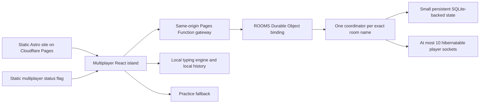

# NinjaType multiplayer using Cloudflare Durable Objects

Architecture assessment: 24 October 2026. This is the Durable Objects alternative to the Convex assessment. No application code, bindings, deployment settings, or infrastructure were changed.

## Recommended design

Use **one SQLite-backed Durable Object per exact room name**, a thin same-origin HTTP gateway, and **hibernatable WebSockets carrying only room events**. Keep typing, timekeeping, WPM, accuracy, and personal history local.

This is a particularly good fit for ten-person friend rooms. Each room owns its small state and serializes its commands. Broadcasts go directly to enrolled sockets; there is no reactive database query to rerun for each observer and no global room directory to query.

Free-only operation still requires resource limits and practice fallback. Object count can scale horizontally, while account request, duration, and storage allowances remain finite.

## Fit with the existing app

The existing site is a static Astro build on Cloudflare Pages. `src/pages/online.astro` mounts the React race interface. `src/store/online.ts` runs local timing, input, WPM, accuracy, and history; `src/lib/onlineRace.ts` contains reusable normalization and completion rules.

Keep those local capabilities and give multiplayer its own coordinator/store. The current recorded-opponent projection should not be used to simulate the progress of real room members. In a multiplayer room, show joined/ready/finished states and final scores; do not invent opponents' live positions.

The recommended hosting arrangement is:



[Pages bindings documentation](https://developers.cloudflare.com/pages/functions/bindings/) states that a Durable Object class must be deployed in a **separate Worker**, then bound to Pages Functions. It cannot be declared and deployed inside the Pages project itself.

Only `/api/multiplayer/*` should enter the dynamic gateway. Static pages/assets and solo practice should continue through the existing static hosting. The gateway calls the namespace binding directly; it does not need an extra public HTTP hop through the Worker exporting the class.

The exporting Worker should not expose an alternate public room proxy that bypasses the gateway. The gateway overwrites internal identity headers with verified guest identity and checks the browser's exact allowed Origin for state-changing requests and WebSocket upgrades. Origin checking is a browser protection, not authentication against arbitrary HTTP clients.

A dedicated Worker route under the same hostname is another deployment arrangement with the same logical architecture. A different API hostname is possible but complicates cookies, origin validation, and local development. Same-origin routing is the preferred default.

The new DO Worker needs a SQLite class migration (`new_sqlite_classes`) to operate on Workers Free. Its compatibility date should be chosen and tested independently from the existing Pages date. Relevant current behavior changes include `deleteAll()` deleting alarms from 2026-02-24 and automatic close-frame replies from 2026-04-07.

## Room lookup without a directory

Normalize names using a deliberately narrow policy: trim outer whitespace, preserve case, require 8–48 ASCII letters/numbers/underscores/hyphens. Eight characters is a proposed initial minimum, not a privacy guarantee. Generate an unpredictable default name, and allow valid custom names.

Derive the namespace identity from a stable key such as:

```text
room:v1:<exact-normalized-name>
```

`ROOMS.getByName(key)` or `idFromName(key)` plus `get(id)` routes all operations for that name to the same room object. Two creators choosing the same name reach the same coordinator; its atomic state transition admits exactly one creation.

An unmatched **join** returns room-not-found; only an explicit **create** initializes room state. A missing-name lookup can still activate an object and consume a request. It should not write a placeholder room, create extra application tables, schedule an alarm, or accept a socket.

A name-derived object address can be reused after expiry. Every successful room creation therefore gets a new random **room epoch**. All membership, commands, reconnects, and results must include or be bound to that epoch. This prevents an old invite/credential/result from acting on a replacement room with the same name.

Anyone who knows the room name can request a seat. Name-only entry is an invitation model, not strong private-room authentication. An unpredictable default reduces casual guessing.

## Guest identity and entry

Use a signed guest credential, rather than trusting nicknames. A same-origin gateway can issue a short-lived Secure, HttpOnly, SameSite cookie for an anonymous guest. Verify it before calling the object, and bind the guest ID to the room's durable membership. Creator privileges come from room state, not client-supplied role claims.

The first successful create/join response can establish the guest cookie; an extra standalone login endpoint is unnecessary. Cookie expiry should outlast the room's maximum lifetime. Room epoch and membership are still checked by the coordinator on reconnect and commands.

Browser WebSocket constructors cannot set arbitrary Authorization headers. A same-origin cookie avoids putting long-lived credentials in WebSocket URLs, logs, or shared invitation links. A short-lived one-use connection ticket is an alternative if cookie-based deployment is unsuitable, but adds another protocol/persistence decision.

The coordinator accepts at most one active socket per member and at most ten member sockets. A replacement tab can take over the existing member socket without allocating another seat. Socket-close handlers must not delete a replacement connection's membership.

Anonymous users can create multiple guest identities using different browsers. Preventing one person from filling several seats would require a different account/identity policy.

## Race protocol

Use HTTP for initial entry and connection establishment:

| Operation | Responsibility |
| --- | --- |
| Create | Initialize the room, epoch, creator seat, settings, bounded text and expiry |
| Join | Verify exact name/epoch, capacity and phase; return the existing seat or add one |
| Connect | Validate guest membership; accept/replace its hibernatable WebSocket and send a fresh snapshot |

After entry, the socket carries a small set of commands:

| Command | Durable change |
| --- | --- |
| READY | One-time readiness transition for this lobby/round |
| START | One immutable participant roster, future `startAt`, deadline and round ID |
| FINISH | One final result for this member and round |
| LEAVE | Remove a waiting-room seat; a racing participant remains in the locked roster |
| REMATCH | Advance the round ID, clear readiness/results, establish the next lobby |
| SYNC | Return the current snapshot; no persistent state change |

Every envelope has a protocol version and request ID. Mutating commands specify the expected room epoch and round ID. Replies acknowledge the request ID; state events carry a monotonic sequence number. Duplicate READY/START/FINISH operations return the existing outcome rather than writing again.

On join/reconnect, send a complete compact snapshot. For normal changes, send small sequenced room events. A client that detects a sequence gap requests one snapshot instead of repeatedly polling.

The client can prepare and preview the same bounded text before acknowledging readiness. Starting freezes the roster and settings. Any enrolled member can start when the agreed conditions hold—for example, at least two members and all joined members ready. The creator can manage stale waiting seats. This avoids making the creator's live connection a prerequisite for the race.

Publish a start timestamp about five-to-ten seconds in the future, subject to latency verification. Include `serverNow`; reuse existing request round-trip measurements to estimate clock offset. Countdown and elapsed time run locally using timestamps and a monotonic clock, rather than assuming timer callbacks occur on schedule.

The client sends **no typing text, keystrokes, progress samples, or periodic WPM updates**. It submits one bounded result with elapsed time, errors/accuracy inputs and an idempotency identifier. The server derives consistent WPM from the known passage length, validates ranges, membership, epoch, round and deadline, and records a server receipt timestamp. These checks do not prove human typing or prevent all cheating.

The socket may stay connected while the player types. Because it is hibernatable, an idle room can sleep while connections remain open. Finish events wake it briefly and broadcast completed results. There is no need to close and reopen a healthy socket just to reduce idle duration consumption.

## State and atomicity

For this bounded room, start with **one compact canonical room snapshot** persisted using the Storage API on a SQLite-backed object. A target such as 8 KB is ample for short tracks, ten members, readiness, current results, IDs and a bounded idempotency record.

Suggested fields:

```text
schemaVersion, protocolVersion
roomName, roomEpoch, creatorMemberId
sequence, roundId, settings, exactText
phase, participantIds, startAt, deadlineAt
createdAt, lobbyExpiresAt, absoluteExpiresAt, resultsExpireAt
members[<=10]: guestId, memberId, displayName, ready, result
bounded recent operation IDs needed for recovery
```

This differs from the Convex design: DO storage pricing uses rows rather than document-byte I/O, and a room owns a small in-memory working set. Rewriting one bounded state value on an occasional event is reasonable. A normalized SQLite layout could become worthwhile for larger rooms or retained histories, but those are outside the current requirements.

Persist each meaningful change; avoid writing when a duplicate command, SYNC or socket close does not change membership. The latest round/results live in the object; personal typing history remains in the existing browser storage.

Durable Objects are single-threaded, but arbitrary `await` boundaries can still permit interleaving. Keep validation, seat allocation, round changes and persistence within a storage-safe atomic transition; avoid external network I/O between checking a condition and writing the new state. Use the platform's input/output gates or an appropriate storage transaction. Do not enable unconfirmed output for accepted joins, starts or final results.

Load persisted room state on wake. Rebuild socket associations using `getWebSockets()` and small serialized attachments containing member/epoch information. Attachments survive hibernation of healthy sockets, but not socket closure or deployment disconnects; authoritative membership and results therefore belong in storage.

## Hibernation and room cleanup

Use `ctx.acceptWebSocket()` and the DO `webSocketMessage`/close/error handlers. Standard `socket.accept()` plus event listeners prevents the intended hibernation behavior.

Avoid DO `setInterval`, recurring `setTimeout`, server countdown ticks, open outbound sockets and unfinished long-running requests. Browser-local timers are fine. The exporting Worker/gateway should finish forwarding the handshake rather than running an application relay loop.

Display **joined**, not a continually heartbeated assertion of online presence. A dropped socket retains its seat for reconnect or explicit lobby removal. Protocol ping/pong frames are handled by the runtime without waking the room. Application heartbeats are optional; they should not be added by default simply to maintain an online dot.

Each room has one alarm slot. Schedule the next relevant lifecycle deadline, not a timer per player:

- Initial lobby expiry: proposed fifteen minutes after lobby creation.
- Race deadline: proposed maximum ten minutes after the shared start.
- Results retention: proposed ten minutes, bounded by an absolute two-hour room lifetime.

These are fixed phase windows, not an expiry timestamp rewritten on every keystroke or heartbeat. Rematches can extend the current phase window within the absolute lifetime. Alarm changes happen at phase boundaries, with only a few writes per round.

An alarm that reaches the race deadline marks missing results DNF/DNS, persists once if needed, broadcasts the outcome and schedules retention cleanup. Results may also complete early when the final FINISH arrives. Alarms are at-least-once and can be delayed/retried: the handler always rechecks persisted epoch, phase and deadlines before acting. A stale alarm must not delete a replacement room or a later rematch.

At final expiry, close player sockets, remove any alarm as required by the compatibility date, call `storage.deleteAll()` and clear the in-memory state. Deleting only a `room` value can leave internal SQLite metadata; `deleteAll()` deallocates the object's stored data. Logical expiry is enforced on each operation even if physical cleanup is delayed.

Alarms have a finite automatic retry policy, so a prolonged outage can exhaust cleanup retries. A later request must recheck expiry and repair cleanup. Storage monitoring is still necessary; an alarm is not a guarantee that every expired object is promptly deleted under every failure condition.

## Free-tier accounting and capacity

The captured official pricing lists:

| Resource | Workers/DO Free allowance |
| --- | ---: |
| Dynamic Workers/Pages Function requests | 100,000/day |
| Gateway Worker CPU | 10 ms/request |
| Durable Object requests | 100,000/day |
| Durable Object duration | 13,000 GB-seconds/day |
| SQLite rows read | 5 million/day |
| SQLite rows written | 100,000/day |
| SQLite stored data | 5 GB total |

Keep the account on Free. Exceeding a daily allowance causes failures rather than paid overages; the daily allowances reset at 00:00 UTC. Storage usage is persistent and is not reset merely because a day changes. Other projects on the same account share relevant allowances.

Current WebSocket request accounting is especially useful here:

- Opening a socket consumes a request.
- Messages routed through the gateway after upgrade do not become new gateway Worker requests.
- Incoming DO WebSocket messages use a 20:1 request billing ratio.
- Outgoing socket messages are not billed as additional requests.
- Messages still cause processing and meaningful changes still cause storage writes. Cheap message accounting does not make frequent state writes free.

An illustrative fresh ten-player room with one round:

| Activity | Approximate model |
| --- | --- |
| Creator enrollment plus nine joins | 10 HTTP gateway/DO requests |
| Ten socket upgrades | 10 more HTTP gateway/DO requests |
| Ten READY, one START, ten FINISH commands | 21 incoming socket messages, about 1.05 billed DO requests under the published ratio |
| Persistent room transitions | About 31 application state writes |
| Alarms, expiry and other overhead | Additional requests/writes |

This produces roughly 20 gateway requests and low-twenties billed DO requests before reconnects and other overhead. A planning scenario of **40 measured storage-row writes per full room-round** allows some lifecycle overhead but must be verified against actual platform metrics, including internal/index effects.

With that hypothetical measurement and a conservative internal budget of 60,000 row writes/day:

```text
60,000 / 40 = 1,500 full room-rounds/day
1,500 × 10 = 15,000 player-round participations/day
```

This is an arithmetic scenario, not a measured capacity claim. Request limits, active duration, incomplete rooms, abuse, reconnects, retained storage and other account workloads can lower it. Multiple rounds in the same room can amortize initial entry requests, but each new round still has readiness/start/results and cleanup costs.

Hibernation is essential. For example, 100 non-hibernatable rooms kept active for ten minutes consume approximately:

```text
100 × 600 seconds × 0.128 GB ≈ 7,680 GB-seconds
```

That is roughly 59% of the 13,000 GB-seconds/day allowance. Idle hibernatable rooms avoid this duration consumption while their clients stay connected. Actual duration depends on event processing and whether the object remains eligible to sleep.

## Maintenance and budget protection

Use a static status flag served with practice assets and a gateway maintenance setting. The gateway checks whether entry is enabled before invoking a room. Invalid origins, credentials, names, payload sizes and request shapes should be rejected before DO activation wherever possible.

The DO separately validates and bounds every incoming WebSocket command; messages do not pass through a fresh gateway invocation. Give each member a small command-rate allowance, reject repeated invalid operations and close abusive sockets. Do not perform a durable write just to count every malformed frame.

An operator can disable new entries while allowing bounded existing rounds to finish. A full shutdown may require updating the DO-side setting/deployment or closing existing sockets; changing only an HTTP gateway flag does not disable already-established WebSocket commands. Avoid a global counter object or per-frame external maintenance lookup just to make a small room work.

Resource monitoring and soft admission controls reserve headroom, but measurements are delayed and distributed. They are not an exact global quota reservation. Provider Free hard limits are the final zero-spend safeguard. Unlike the documented Convex disable thresholds, this design does not assume an equivalent configurable automatic threshold exists for every Cloudflare metric.

If a gateway, room operation, storage write or socket acknowledgment fails:

1. Preserve the local passage and local result.
2. Stop repeated network operations after a bounded recovery attempt.
3. Show: **Multiplayer is temporarily unavailable. You can keep practicing.**
4. Offer practice and an explicit retry.
5. Mark a timed-out FINISH as unconfirmed, and reuse its operation ID when retrying.

Practice must not require the exhausted dynamic gateway to render this message. The static island contains its own fallback. Keep the status flag and all multiplayer API/socket state out of stale PWA caching. If only the user's network is offline, use a connection-specific explanation.

## Edge cases specific to this design

| Scenario | Required behavior |
| --- | --- |
| Two creators use the same name | Same name-derived object; atomic creation returns one winner |
| Multiple joins compete for seat ten | One atomic seat transition at a time; never exceed ten |
| Typo or missing name | Return not-found without initializing a placeholder room |
| Room name reused after expiry | New epoch; reject all old credentials and commands |
| Hibernation erases memory | Rehydrate room storage and socket attachments; retain the original round |
| Deployment/runtime restart disconnects sockets | Bounded jittered reconnect using the same guest/epoch/round; receive a snapshot |
| New frontend talks to an older object version | Explicit protocol/schema compatibility; meaningful upgrade/fallback response |
| Duplicate tab replaces a socket | Reuse the seat, close the old socket, and ignore stale close effects |
| Socket silently dies while the user types | Local run continues; FINISH acknowledgment timeout triggers bounded reconnect or practice |
| Stale/out-of-order room events | Sequence check and a single SYNC snapshot |
| Duplicate READY/START/FINISH | Idempotent reply without another persistent write |
| Creator disconnects | Round continues; eligible members can start when readiness permits |
| Unready stale seat blocks start | Creator removes it, or lobby expires; no heartbeat-based host election |
| Late newcomer during countdown/race | Roster is locked; allow existing-member recovery only |
| Delayed or repeated alarm | Recheck current phase/epoch/deadline; perform an idempotent transition |
| Alarm races a final result | Consistent boundary/grace policy; duplicate receipt cannot alter finalized results |
| Cleanup retries exhausted | Enforce logical expiry; repair on later access and monitor retained storage |
| Storage/quota failure after attempted write | Do not acknowledge success before persistence; local result remains unconfirmed |
| Wrong clock/background tab | Timestamp-derived timing and late-start policy; no fresh timer on wake |
| Client claims a fake elapsed time or accuracy | Bounds/consistency checks and casual scoring; no claim of cheat-proof competition |

## Alternatives within the DO design

| Variant | Advantage | Tradeoff |
| --- | --- | --- |
| **Hibernatable room sockets — recommended** | Automatic shared lobby/start/results; low gateway calls and direct broadcasts | Reconnect, protocol, persistence and hibernation correctness require careful code |
| HTTP-only host start with polling | Simpler transport and explicit request lifecycle | Polling unchanged rooms consumes dynamic requests and DO activations |
| HTTP-only predetermined future start | Few operations; join returns a race descriptor immediately | Less flexible waiting/ready behavior; players must join before the fixed start |
| In-memory-only rooms | Fewer storage writes | Restarts/hibernation lose authoritative state; staying awake spends duration |
| One global room-directory object | Central listing/admission management | Shared bottleneck and extra operations; unnecessary for exact-name joining |

For the current requirements, hibernatable room sockets with persistent compact state are the best balance. Continuous live progress, global room discovery, server-side personal history and strict anti-cheat are outside the proposed coordinator's scope.

## Sources and boundaries

- [Durable Objects pricing](https://developers.cloudflare.com/durable-objects/platform/pricing/)
- [Workers and Pages Functions pricing](https://developers.cloudflare.com/workers/platform/pricing/)
- [Hibernation and WebSockets](https://developers.cloudflare.com/durable-objects/best-practices/websockets/)
- [Durable Object lifecycle](https://developers.cloudflare.com/durable-objects/concepts/durable-object-lifecycle/)
- [SQLite-backed Storage API and atomicity](https://developers.cloudflare.com/durable-objects/api/sqlite-storage-api/)
- [Alarms and retries](https://developers.cloudflare.com/durable-objects/api/alarms/)
- [Pages bindings to a separately deployed DO Worker](https://developers.cloudflare.com/pages/functions/bindings/)
- [Durable Objects limits](https://developers.cloudflare.com/durable-objects/platform/limits/)

Official source captures are in `evidence/`. Pricing captures were gathered during the preceding architecture assessment in the same session; protocol/lifecycle/storage/Pages details were inspected for this redesign. No deployment was created or modified, and no runtime benchmark was performed.
